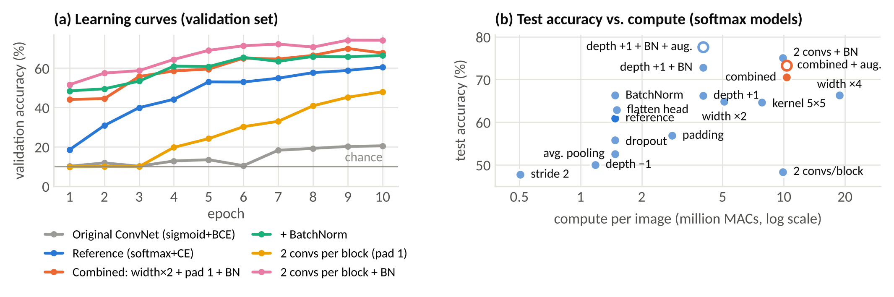
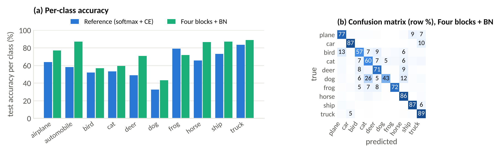

# What makes a small CNN work on CIFAR-10?

Architecture experiments on the ConvNet from the course notebook, done for Task 3 of *Kecerdasan Komputasional dan Pembelajaran Mesin* (Kelas B252), Magister Ilmu Komputer, Universitas Gadjah Mada.

**Osama Yehya Ghazal** · NIM 26/591650/PPA/07466

Two folders: [`01-given-by-lecturer/`](01-given-by-lecturer) is the starting point as handed out, [`02-my-work/`](02-my-work) is everything I produced.

The course notebook `colab_img_clf.ipynb` trains a small convolutional network on CIFAR-10, and the task was to run it, change the architecture and explain what the changes do. When I ran the notebook as given it did not learn at all: 9.9–11.3% test accuracy over five seeds, which is chance for ten classes. So the first part of the work was finding out why. After fixing that, I changed one design element at a time under a fixed training protocol and compared the results.

- 📄 Report (3 pages): [`02-my-work/Task3_CNN_Report_Osama_Yehya_Ghazal.pdf`](02-my-work/Task3_CNN_Report_Osama_Yehya_Ghazal.pdf)
- 📓 Colab notebook that reproduces every run: [`02-my-work/Task3_CNN_experiments.ipynb`](02-my-work/Task3_CNN_experiments.ipynb)

## Main results

| Model | Test accuracy |
|---|---|
| Notebook as given (sigmoid + BCE, red channel only, 1 epoch, 5 seeds) | 9.9–11.3 % |
| Same model with the loader fixed, 10 epochs | 20.9 % |
| Reference: same layers, softmax + cross-entropy (3 seeds) | 61.2 ± 0.4 % |
| + BatchNorm (3 seeds) | 67.1 ± 0.8 % |
| Combined: width ×2 + padding + BatchNorm (3 seeds) | 68.9 ± 1.6 % |
| Four blocks + BatchNorm (3 seeds) | **73.5 ± 1.8 %** |
| Combined + augmentation + cosine LR, 15 epochs | 73.3 % |
| Four blocks + BatchNorm + augmentation + cosine LR, 15 epochs | **77.6 %** |

## What I found

- **The sigmoid output is why the notebook does not learn.** With BCE averaged over ten sigmoid outputs, the network quickly settles on predicting 0.1 for every class (loss ≈ 0.325) and stays there for several epochs. Switching to softmax + cross-entropy, with the same layers, fixes it.
- **The data loader only uses the red channel.** `myData` slices `[0:1024]` for all three channels. Fixing it is worth 7.8 points.
- **BatchNorm is the best value of any single change:** +5.8 points over three seeds for 224 extra parameters. It also rescues the deeper networks: two convs per block goes from 48.4 % without it to 75.1 % with it, and four blocks from 66.2 % to 73.5 % (3 seeds).
- **With BatchNorm, depth beats width.** Four blocks + BatchNorm (4.0M MACs) beats the wider combined model (10.3M MACs) by 4.6 points.
- **Depth helps when it enlarges the receptive field.** Two blocks see only a 10×10 patch (−10.9); a fourth block sees the whole image (+5.3).
- **Width has diminishing returns:** ×2 filters gives +4.0, and ×4 only 1.4 points more than that, for 12.7× the reference compute.
- **Padding only helps if a further block uses it:** padding alone costs 4.1 points, but the four-block network it makes possible gains +5.3.
- **Downsampling:** average pooling gives −8.4 and stride-2 convolutions −13.2 compared with max-pooling.
- **Dropout hurts here** (−5.1) because after 10 epochs the models are still under-fitting.




## Setup

Same as the course notebook: train on `data_batch_1, 3, 5` (30k images), validate on `data_batch_2, 4` (20k), test on `test_batch` (10k); SGD with lr 0.0025, momentum 0.9 and batch size 10. The only training change is 10 epochs instead of 1 (the two augmented runs use random crops, flips and a cosine schedule for 15 epochs). I keep the checkpoint with the lowest validation loss, so model selection never looks at the test set.

## How to run it

**On Colab (easiest):** open `02-my-work/Task3_CNN_experiments.ipynb`, choose a T4 GPU, put the `cifar-10-batches-py` folder in your Google Drive and set `root_data` in the first cell. Set `SMOKE = True` first if you only want to check that everything runs.

**Locally:**
```bash
pip install -r requirements.txt
# download CIFAR-10 (python version) and extract it to data/cifar-10-batches-py
export CIFAR_DIR=data/cifar-10-batches-py
python 02-my-work/src/train.py --name batchnorm --cfg '{"bn": true, "out": "softmax"}' --epochs 10
python 02-my-work/src/run_all.py 02-my-work/experiments.json results     # every run in the report (slow on a CPU)
python 02-my-work/src/recheck.py results                      # reload the saved checkpoints and re-test them
```

## Repository layout

```
01-given-by-lecturer/     the course notebook, as handed out
02-my-work/               everything I produced
  Task3_CNN_Report_...pdf   the 3-page report (this is the submission)
  Task3_CNN_experiments.ipynb   Colab notebook reproducing all 34 runs
  src/                      train.py, run_all.py, recheck.py, analyze.py, check_effnet.py
  figures/                  the two figures in the report
  results/                  summary.csv, all_runs.json, training_logs.txt, bench.json, recheck.log
  experiments.json          configuration of all 34 runs
```

## Notes

- All runs use the original CIFAR-10 python batch files supplied with the course, so the numbers here are directly comparable with the notebook's own. For reference, the course's pretrained EfficientNet checkpoint (`modelz.pth`) scores 76.2 % on the same test set when evaluated through the notebook's own pipeline.
- All runs were trained on a CPU for 10 epochs (15 for the augmented runs). Most use a single seed, so differences under about 2 points are within noise.
- The dataset and model checkpoints (`*.pth`) are not included. `02-my-work/results/recheck.log` records the verification I ran: every one of the 34 saved checkpoints was reloaded and re-scored, and each matched its reported accuracy exactly.
